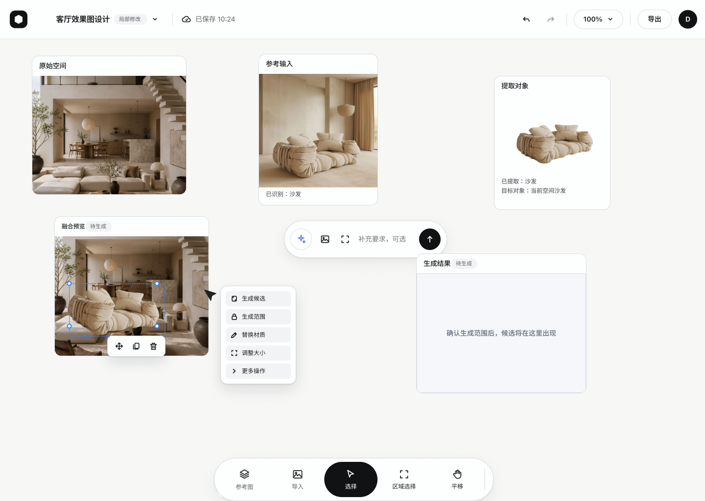
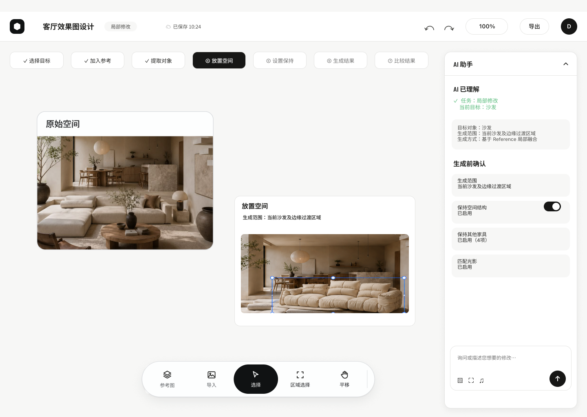
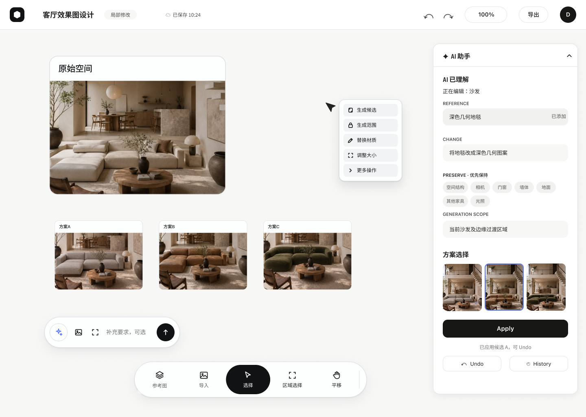

# AI Image Editing UX

`ITERATE` case study for an indoor AI image-editing workflow.

## 简介

In interior image editing, “change this” is only half of the task. The user also needs to protect spatial structure, scale, lighting, materials, and unrelated objects. This project explores how an editing contract can become visible before a generative edit is applied.

I framed the interior-design constraints, mapped the interaction model, compared three product directions, and distilled the work into static visual evidence. The key design move is to separate **change** from **keep**, then make AI understanding, candidate comparison, and reversible decisions visible.

## Latest visual evidence

These are direct exports of the latest complete Figma frames, verified on 2026-10-20:

- Figma file: `OQFyibG49fomUftKGp2JAl`
- Page: `01 · Screens` (`3:51`)
- V1: `25:4` · V2: `282:2288` · V3: `278:1025`

### V1 · START

Expose the initial workflow: original space, reference input, extracted object, selected placement, and a pending result.

### V2 · EXPOSE

Make the generation stage explicit: the user can review the placement space and confirm generation scope, preserved structure, other furniture, and lighting before generation.

### V3 · NARROW

Reduce the decision to change, preserve, compare, apply, undo, and history while keeping the room canvas central.

## V1 → V2 → V3

| Version | Design move | Trade-off |
|---|---|---|
| V1 · START | Expose the source → reference → extracted object → placement flow. | More process visibility, but the user may manage a workflow rather than an edit. |
| V2 · EXPOSE | Surface AI understanding, generation scope, and priority-preserve items before generation. | Earlier correction of misunderstandings, with more reading load. |
| V3 · NARROW | Keep the canvas central and make candidate comparison plus apply / undo / history explicit. | A shorter decision path, still requiring validation of range understanding and recovery behavior. |

## Repository scope

This is a static interaction-design case study. It does not provide online image generation, a runnable product, or measured outcome claims. The three PNGs are Figma frame exports, not generated substitutes or screenshots of a live model result.

The reasoning, evidence source, task flow, AI/user division, and validation boundaries are in [`docs/design-decisions.md`](docs/design-decisions.md).

No license is included.
