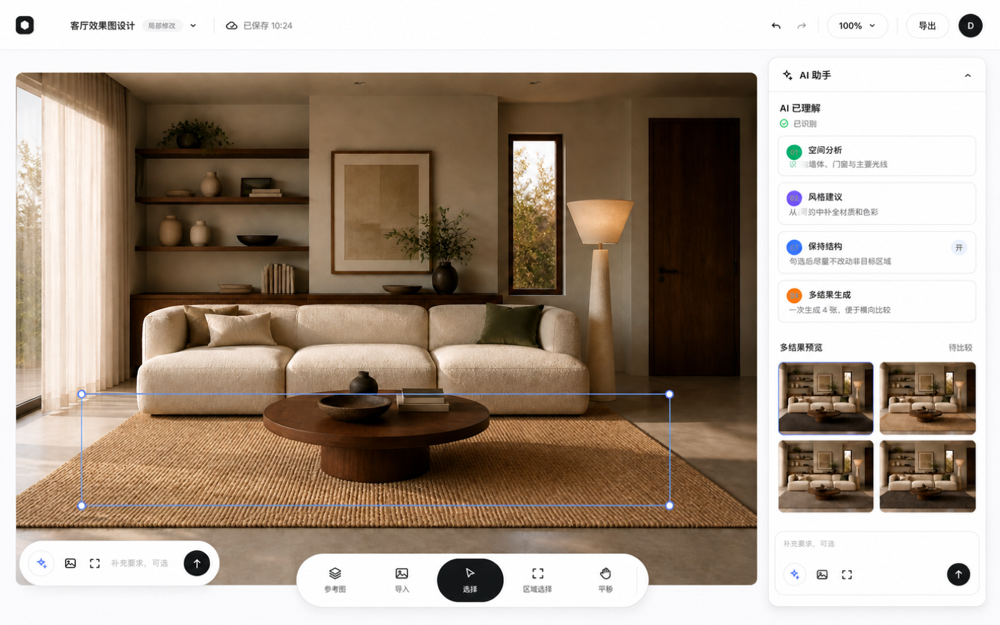
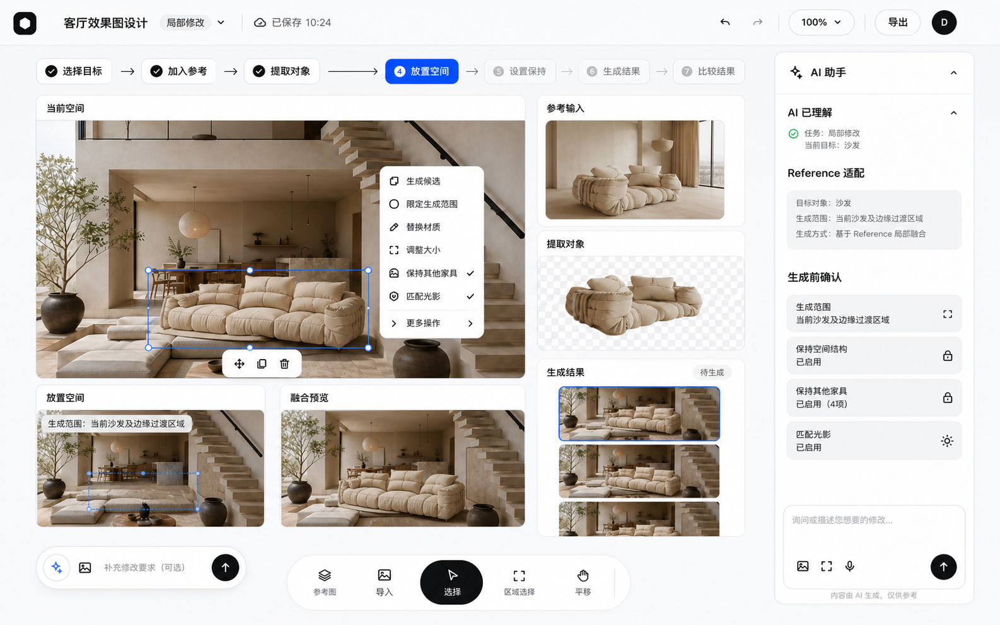
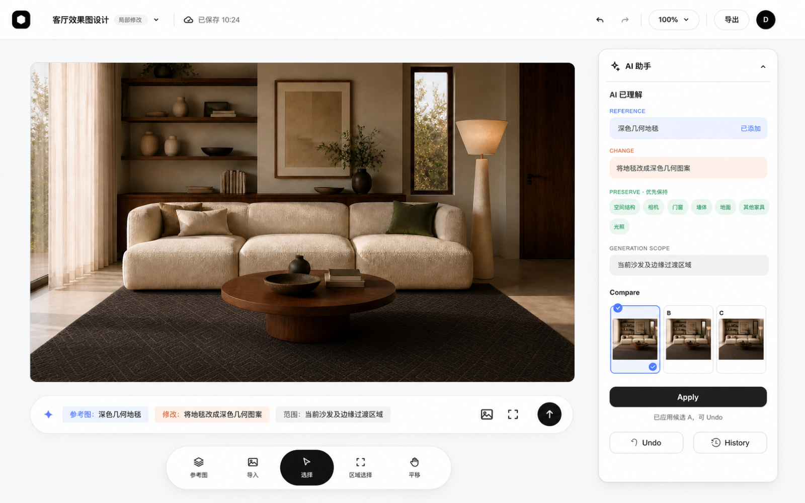

# AI Image Editing UX

`ITERATE` case study for an indoor AI image-editing workflow.

## The problem

In an interior image edit, “change this” is only half of the task. The user also needs to protect spatial structure, scale, lighting, materials, and unrelated objects. The project explores how to make that change contract visible before a generative edit is applied.

## My contribution

I framed the vertical interior-design constraints, mapped the interaction model, compared three product directions, and distilled the work into static visual evidence. The core design decisions are the separation of **change** and **keep**, explicit AI-understanding states, candidate comparison, and reversible apply / undo decisions.

This repository presents the interaction reasoning and static solution evidence without inventing project responsibilities or outcome metrics.

## Three iterations

| Version | Design move | Trade-off |
|---|---|---|
| V1 · START | Expose the generation chain: source image → reference → extracted object → fusion preview → result. | More process visibility, but the user may end up managing a workflow rather than an interior edit. |
| V2 · EXPOSE | Make AI understanding, reference fit, generation scope, and priority-preserve items visible before generation. | Earlier correction of misunderstandings, but too much explanation can increase reading load. |
| V3 · NARROW | Reduce the task to object / region, keep constraints, candidate comparison, and apply / undo / history. | A shorter decision path, still requiring validation of range understanding and recovery behavior. |

The three visual references are available in [`assets/`](assets/). They are the primary reading material for this repository.

### Visual comparison

## Repository scope

This is a static interaction design case study. It does not provide online image generation, a runnable product, or a code demo. The three interface images were created as visual design material with built-in image generation; they are not evidence of live model output or measured product outcomes.

Detailed design decisions and validation boundaries are in [`docs/design-decisions.md`](docs/design-decisions.md).

No license is included.
